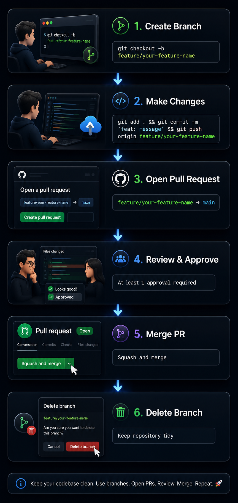

# GitHub Flow - MacroCrypto AI

This document outlines our team's development workflow. Follow these steps for every change, big or small.

---

## 🔄 The Workflow (6 Steps)

### 1. Create a Feature Branch

Always start from `main`:

```bash
git checkout main
git pull origin main
git checkout -b feature/your-feature-name
```

**Branch naming conventions:**

| Type | Format | Example |
|------|--------|---------|
| New feature | `feature/description` | `feature/data-ingestion` |
| Bug fix | `bugfix/description` | `bugfix/rabbitmq-connection` |
| Documentation | `docs/description` | `docs/api-readme` |
| Hotfix | `hotfix/description` | `hotfix/security-patch` |

---

### 2. Make Changes

Write code, commit, and push regularly:

```bash
git add .
git commit -m "feat: add data ingestion endpoint"
git push origin feature/your-feature-name
```

**Commit message format:**

| Type | Description | Example |
|------|-------------|---------|
| `feat:` | New feature | `feat: add price forecasting endpoint` |
| `fix:` | Bug fix | `fix: handle RabbitMQ reconnection` |
| `docs:` | Documentation | `docs: update API documentation` |
| `refactor:` | Code refactor | `refactor: optimize database queries` |
| `test:` | Testing | `test: add unit tests for AI service` |
| `chore:` | Maintenance | `chore: update dependencies` |

---

### 3. Open a Pull Request

1. Go to the repository on GitHub
2. Click **"Pull Requests"** → **"New Pull Request"**
3. Select: `main` ← `feature/your-feature-name`
4. Fill in the PR template:
   - **Title:** Brief description of the change
   - **Description:** What changed, why, and how to test
   - **Link to issue:** (if applicable)
5. Click **"Create Pull Request"**

**PR Title Format:**
```
[Service] Brief description of the change
```

**Examples:**
- `[Data Ingestion] Add CoinGecko API integration`
- `[AI Service] Implement price forecasting model`
- `[API Gateway] Add JWT authentication`

---

### 4. Review and Address Feedback

- **Reviewer:** At least one team member must approve
- **Address comments:** Push new commits to the same branch
- **Request re-review:** When ready, request review again

**As a Reviewer:**
- Check code quality
- Verify tests pass
- Test the changes locally (if needed)
- Approve or request changes

**As an Author:**
- Address all comments
- Push fixes to your branch
- Do not merge without approval

---

### 5. Merge the PR

Once approved and all checks pass, merge via GitHub UI:

**Merge strategy:** Use **"Squash and merge"** to keep history clean.

```
Squash and merge → Clean, single commit on main
```

**Before merging, ensure:**
- ✅ At least 1 approval
- ✅ All comments resolved
- ✅ All status checks pass (CI/CD)
- ✅ Branch is up to date with main

---

### 6. Delete the Branch

After merging, delete the feature branch on GitHub (the UI offers a button).

```bash
# Or delete locally after merging
git checkout main
git pull origin main
git branch -d feature/your-feature-name
```

---

## ✅ Key Rules (Do's and Don'ts)

| ✅ Do | ❌ Don't |
|-------|----------|
| Create a branch for every change | Push directly to `main` |
| Open a PR for every change | Merge without approval |
| Request at least 1 review | Ignore PR comments |
| Keep branches short-lived (1-7 days) | Merge without passing tests |
| Write clear commit messages | Delete a branch before merging |
| Delete branches after merging | Rebase a shared branch |

---

## 🔒 Branch Protection Rules

These are enforced by GitHub:

| Rule | Status |
|------|--------|
| Direct commits to `main` | ❌ BLOCKED |
| Merging without PR | ❌ BLOCKED |
| Merging without 1 approval | ❌ BLOCKED |
| Merging with failed status checks | ❌ BLOCKED (when configured) |
| Force pushes to `main` | ❌ BLOCKED |
| Deleting `main` | ❌ BLOCKED |

---

## 📊 Visual Workflow




---

## 🔄 What If Something Goes Wrong?

| Situation | Action |
|-----------|--------|
| Merge conflict | Resolve locally: `git pull origin main` → fix → commit → push |
| PR comments need addressing | Push new commits to same branch (approval resets) |
| Accidentally pushed to `main` | ❌ Shouldn't happen (protected branch) |
| Need to revert a merge | Use `git revert` (don't rewrite history) |
| Stuck or blocked | Ask for help in team channel |

---

## 📚 Quick Cheat Sheet

### Daily Commands

```bash
# Start new work
git checkout main && git pull origin main
git checkout -b feature/your-feature-name

# Regular commits
git add .
git commit -m "feat: add endpoint"
git push origin feature/your-feature-name

# Before merging (keep branch up to date)
git checkout main && git pull origin main
git checkout feature/your-feature-name
git merge main  # or rebase

# After merge (clean up)
git checkout main
git pull origin main
git branch -d feature/your-feature-name
```

---

## 🆘 Helpful Links

- [GitHub Flow Guide](https://docs.github.com/en/get-started/using-github/github-flow)
- [Writing Good Commit Messages](https://www.freecodecamp.org/news/how-to-write-better-git-commit-messages/)
- [Pull Request Etiquette](https://www.atlassian.com/blog/git/pull-requests)

---
