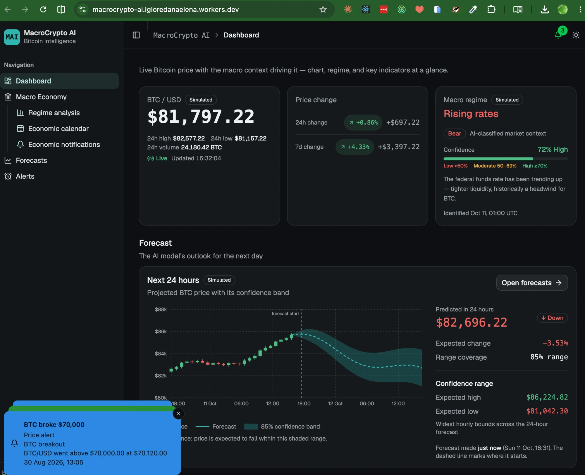

# MacroCrypto AI

**AI-powered Bitcoin intelligence driven by macroeconomic data.**

> **🚀 Live app: [https://macrocrypto-ai.lgloredanaelena.workers.dev/](https://macrocrypto-ai.lgloredanaelena.workers.dev/)**

Quantic MSSE capstone (cohort November 2026). GitHub repository for [TheQuintet/macrocrypto-ai](https://github.com/TheQuintet/macrocrypto-ai).

Traders and analysts today split Bitcoin prices (CoinGecko, TradingView) from macroeconomic series (FRED). This platform puts **BTC market data, macro indicators, forecasts, and alerts** in one dashboard so users can see *why* price is moving, not only *what* it is.

| Persona | Need |
|---------|------|
| **BTC Trader** | Fast 24-hour and 7-day price, macros, and alerts |
| **Investment Analyst** | Historical and indicator views they can check against official sources |

Full problem, scope, and personas: [docs/project-scope.md](./docs/project-scope.md) · [docs/user-personas.md](./docs/user-personas.md).

Program rules and the five mandatory deliverables: [docs/quantic/README.md](./docs/quantic/README.md).



*Dashboard from the deployed app. Some panels, such as the macro regime and forecast, show simulated data, as labelled.*

---

## Sprint demo recordings

> **🎥 [Watch the capstone sprint demo recordings on Google Drive →](https://drive.google.com/drive/folders/1Od4IBbhJyKtgLh-FnUjQ7cMjYWkVm-_I?usp=sharing)**

Meeting notes for each sprint (the recordings above are one shared folder):

| Sprint | Dates (board) | Meeting notes |
|--------|---------------|---------------|
| Pre-Sprint 1 | before 4 Aug | [20 Jul kickoff](./docs/meetings/pre-sprint-1-2026-07-20-kickoff.md) · [29 Jul refinement & planning](./docs/meetings/pre-sprint-1-2026-07-29-refinement-and-planning.md) |
| Sprint 1 | 4–10 Aug | [5 Aug retro, review & planning](./docs/meetings/sprint-1-2026-08-05-retrospective.md) |
| Sprint 2 | 11–17 Aug | _no notes (12 Aug recording had no audio)_ |
| Sprint 3 | 18–24 Aug | [19 Aug weekly sync](./docs/meetings/sprint-3-2026-08-19-sync.md) |
| Sprint 4 | 25–31 Aug | [26 Aug review, refinement & planning](./docs/meetings/sprint-4-2026-08-26-review-and-planning.md) |
| Sprint 5 | 1–7 Sep | [2 Sep review & planning](./docs/meetings/sprint-5-2026-09-02-review-and-planning.md) · [4 Sep Dr. Robert checkpoint](./docs/meetings/sprint-5-2026-09-04-dr-robert-steele-checkpoint.md) |
| Sprint 6 | 8–14 Sep | [9 Sep review & planning](./docs/meetings/sprint-6-2026-09-09-review-and-planning.md) |
| Sprint 7 | 15–21 Sep | [16 Sep weekly sync](./docs/meetings/sprint-7-2026-09-16-sync.md) |
| Sprint 8 | 22–28 Sep | [23 Sep review & planning](./docs/meetings/sprint-8-2026-09-23-review-and-planning.md) |
| Sprint 9 | 29 Sep–5 Oct | [30 Sep review & planning](./docs/meetings/sprint-9-2026-09-30-review-and-planning.md) |
| Post-Sprint 9 | after 5 Oct | [7 Oct final demo planning](./docs/meetings/post-sprint-9-2026-10-07-final-demo-planning.md) |

---

## Contents

- [Sprint demo recordings](#sprint-demo-recordings)
- [Team](#team)
- [Architecture](#architecture)
- [Repository layout](#repository-layout)
- [Run locally](#run-locally)
- [Test](#test)
- [Deploy](#deploy)
- [Agile process](#agile-process)
- [Design and testing documentation](#design-and-testing-documentation)
- [Documentation map](#documentation-map)
- [Contributing](#contributing)

---

## Team

Capstone requires a named **Product Owner** and **Scrum Master**. Current assignments:

| Member | Capstone / primary role |
|--------|-------------------------|
| Sid Ahmed Mahieddine | **Product Owner** |
| Loredana Lungu | **Scrum Master** (frontend) |
| Mael Taye Deneke | **Code Owner** (backend) |
| Kingson Emma-Ochu | Frontend |
| Richard Owusu (Ph.D.) | Frontend and ML |

Contacts, timezones, and availability: [docs/team-roles.md](./docs/team-roles.md).

---

## Architecture

Event-driven microservices. Collectors publish on **RabbitMQ**; services store history in **TimescaleDB (Postgres)** and cache in **Redis**. The dashboard is a separate React app. We chose this so data ingestion, forecasting, and alerts can scale independently — [ADR-003](./docs/design/adr/ADR-003-event-driven-architecture.md), [ADR-001](./docs/design/adr/ADR-001-use-rabbitmq.md).

**`make up`** (repository root) starts the containers below. The **frontend** is not in Compose — run it on the host (`npm run dev`, port **3000**); it calls the API gateway only.

| Group | Container name | Host port(s) | Purpose |
|-------|----------------|--------------|---------|
| **Infrastructure** | `macro-postgres` | 5432 | TimescaleDB / Postgres |
| | `macro-redis` | 6379 | Cache |
| | `macro-rabbitmq` | 5672, 15672 (mgmt UI) | Event bus |
| | `macro-mlflow` | 5000 (UI/API) | Model tracking for ai-service |
| **Microservices** | `macro-api-gateway` | 8000 | External REST entry |
| | `macro-data-service` | 8001 | BTC + macro ingestion/APIs |
| | `macro-ai-service` | 8002 | Forecasting |
| | `macro-alert-service` | 8003 | Alerts |

Swagger and health URLs for the four backend apps: [Run locally — Backend](#backend). Compose runbook (env files, Make targets, troubleshooting): [services/README.md](./services/README.md). Diagrams and boundaries: [C4 model](./docs/design/c4-model.md) · [microservices](./docs/design/microservices.md).

---

## Repository layout

```
macrocrypto-ai/
├── Makefile                 # Backend Compose commands (run from this folder)
├── docker-compose.yml
├── frontend/                # Dashboard
├── services/                # data-service, alert-service, ai-service, api-gateway
├── shared/                  # Shared backend code
├── infrastructure/          # Supporting scripts (for example DB init)
├── docs/                    # Scope, design, Agile, Quantic
├── GITHUB_FLOW.md
└── CONTRIBUTING.md
```

---

## Run locally

A grader (or new teammate) should be able to clone, start the backend, and open the UI from this section. Prerequisites: **Docker Desktop** running, **make**, **Node.js 20+** and **npm**.

### Backend

In the repository root:

```bash
cp services/data-service/.env.example services/data-service/.env
cp services/alert-service/.env.example services/alert-service/.env
cp services/ai-service/.env.example services/ai-service/.env
cp services/api-gateway/.env.example services/api-gateway/.env
make up
```

**`make up`** (repository root) starts the full backend stack via Docker Compose: **Postgres (TimescaleDB)**, **Redis**, **RabbitMQ**, **MLflow**, and the four microservices — **api-gateway** (8000), **data-service** (8001), **ai-service** (8002), and **alert-service** (8003). That is the default path for local development and grading.

If you need to rebuild or restart a single microservice while the rest stays running, use **`make data-up`**, **`make alert-up`**, **`make ai-up`**, or **`make api-up`**. More commands live in the Makefile (`make help`) and [services/README.md](./services/README.md).

| Service | Docs | Health |
|---------|------|--------|
| API Gateway | http://localhost:8000/docs | http://localhost:8000/health |
| Data service | http://localhost:8001/docs | http://localhost:8001/health |
| AI service | http://localhost:8002/docs | http://localhost:8002/health |
| Alert service | http://localhost:8003/docs | http://localhost:8003/health |

Env files and troubleshooting: [services/README.md — Quick start](./services/README.md#quick-start).

### Frontend

```bash
cd frontend
npm install
npm run dev
```

Open http://localhost:3000. Scripts and stack: [frontend/README.md](./frontend/README.md).

### Connect UI to live APIs

Point the dashboard at the **API Gateway** (port 8000), not at the services behind it. After the backend is up, from `frontend/`:

```bash
cp .env.example .env.local
```

Set:

```dotenv
VITE_API_GATEWAY_BASE_URL=http://localhost:8000
```

Restart the Vite server so it picks up the variable. Leave the value empty for a frontend-only run with simulated data. Steps: [Connect to the API Gateway](./frontend/README.md#connect-to-the-api-gateway).

---

## Test

Capstone scoring rewards automated tests that a grader can run.

**Frontend** (from `frontend/`):

```bash
npm test                      # Vitest unit tests
npm run test:ui-integration   # Playwright UI integration
```

**Backend** (with `make up` running): per-service pytest targets are documented in [services/README.md](./services/README.md).

What we test and why: [frontend/README.md](./frontend/README.md) (unit / UI integration / E2E split) and the [design and testing](#design-and-testing-documentation) docs below.

---

## Deploy

A **publicly accessible** app is a mandatory deliverable. The live URL and platform are recorded in [docs/quantic/deliverables.md](./docs/quantic/deliverables.md#2-deployed-application) (update that page when the URL exists — not this README).

Step-by-step server setup and redeploy: [Deployment of the backend](./docs/guides/deployment-platform-analysis.md#deployment-of-the-backend).

Secrets stay in environment variables; do not commit `.env` files.

---

## Agile process

We follow Agile with **at least three sprints**, GitHub Issues, and Project boards. Work that is not on a board is not tracked.

| Resource | URL |
|----------|-----|
| Repository | [github.com/TheQuintet/macrocrypto-ai](https://github.com/TheQuintet/macrocrypto-ai) |
| Team Workflow board | [TheQuintet projects #6](https://github.com/orgs/TheQuintet/projects/6) |
| All Work (overview) | [All Work view](https://github.com/orgs/TheQuintet/projects/6/views/6) |
| Sprint planning | [Team Planning](https://github.com/orgs/TheQuintet/projects/6/views/1) |
| Capstone sprints (×3) | [Sprint 1](https://github.com/orgs/TheQuintet/projects/6/views/18) · [Sprint 2](https://github.com/orgs/TheQuintet/projects/6/views/19) · [Sprint 3](https://github.com/orgs/TheQuintet/projects/6/views/20) |
| Sprint 2 retro | [Retro view](https://github.com/orgs/TheQuintet/projects/6/views/10) |

```
PLAN → ASSIGN → WORK → REVIEW → TRACK → CLOSE → RETROSPECT
```

| Ceremony | How we run it | Details |
|----------|----------------|---------|
| Planning | Select stories, estimate, assign owners | [Sprint planning](./docs/project-workflow.md#sprint-planning) |
| Refinement | Clarify acceptance criteria before the sprint | [Backlog refinement](./docs/project-workflow.md#backlog-refinement) |
| Coordination | Domain Slack — no daily standup (live or required offline) | [Coordination](./docs/project-workflow.md#coordination-without-daily-standup-domain-slack) |
| Review | Offline — pull `main` and use the app | [Sprint review](./docs/project-workflow.md#sprint-review) |
| Retrospective | What went well / what to improve | [Retrospective](./docs/project-workflow.md#retrospective) |
| Delivery | Branch from `main`, PR, review, merge | [GitHub Flow](./GITHUB_FLOW.md) |

---

## Design and testing documentation

The written design-and-testing deliverable must be **manual** (no pasted AI prose). Primary entry points:

| Deliverable | Location |
|-------------|----------|
| **Design & architecture** | [docs/design/README.md](./docs/design/README.md) (index into C4, microservices, ADRs, patterns) |
| **Testing approach (local & CI/CD)** | [docs/test-documents/local-and-ci-cd-tests.md](./docs/test-documents/local-and-ci-cd-tests.md) |

Detail by topic under `docs/design/`:

| Document | What it covers |
|----------|----------------|

| [C4 model](./docs/design/c4-model.md) | Context and containers |
| [Microservices](./docs/design/microservices.md) | Boundaries, data, events |
| [Event-driven architecture](./docs/design/event-driven-architecture.md) | Broker and flows |
| [Application of Architectural and Object-Oriented Design Patterns](./docs/design/architectural-object-oriented-patterns.md) | Patterns used in the implimentation |
| [API design](./docs/design/api-design.md) | HTTP surface |
| [ADRs](./docs/design/adr/README.md) | Why RabbitMQ, FastAPI, Prophet, database-per-service |
| [Non-functional requirements](./docs/design/non-functional-requirements.md) | Performance, availability, security |
| [Local and CI testing](./docs/test-documents/local-and-ci-cd-tests.md) | Test types, Playwright UI integration vs system E2E, GitHub Actions jobs |

Submission status for that deliverable: [docs/quantic/deliverables.md](./docs/quantic/deliverables.md#3-design-and-testing-document).

---

## Documentation map

Add or rename long-form docs via [docs/README.md](./docs/README.md), not by expanding this file.

| Need | Page |
|------|------|
| Product scope and personas | [docs/project-scope.md](./docs/project-scope.md) · [docs/user-personas.md](./docs/user-personas.md) |
| Backend runbook | [services/README.md](./services/README.md) |
| Frontend runbook | [frontend/README.md](./frontend/README.md) |
| Team and sprints | [docs/team-roles.md](./docs/team-roles.md) · [docs/project-workflow.md](./docs/project-workflow.md) |
| Capstone grading and policies | [docs/quantic/grading.md](./docs/quantic/grading.md) · [docs/quantic/policies.md](./docs/quantic/policies.md) |
| AI-assisted development (integrity) | [docs/ai-assisted-development-disclosure.md](./docs/ai-assisted-development-disclosure.md) |

---

## Contributing

Branch from `main`, open a pull request, request review. [CONTRIBUTING.md](./CONTRIBUTING.md) · [GITHUB_FLOW.md](./GITHUB_FLOW.md).

This project is proprietary — [LICENSE.md](./LICENSE.md).
