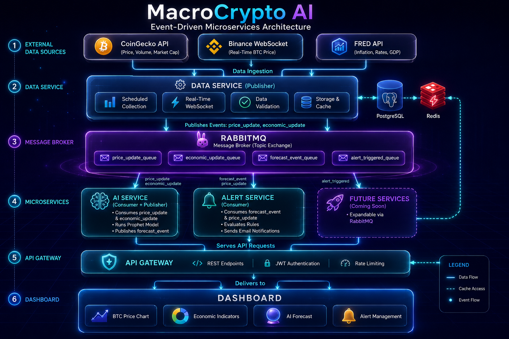
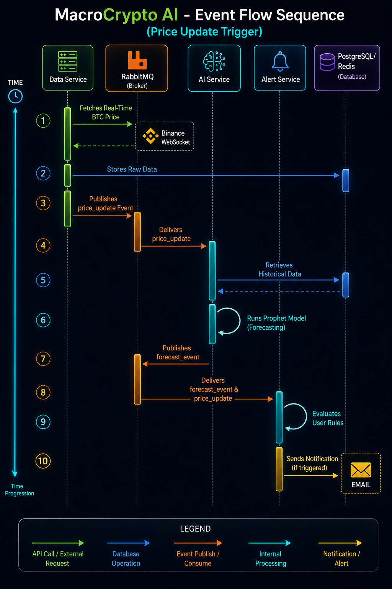

# MacroCrypto AI - Project Scope Summary

## Version 1.0 | Presentation Draft

---

## 1. Executive Summary

**MacroCrypto AI** is a minimum viable event-driven microservices platform that delivers AI-powered intelligence by combining real-time macroeconomic data with Bitcoin market data. The platform provides price forecasting through a web dashboard and REST API.

**Core Value Proposition:**
> *"AI-powered Bitcoin intelligence driven by macroeconomic data."*

**Key Differentiators:**
- **Unique Data Fusion:** Bitcoin + Economic data in one platform
- **Event-Driven Architecture:** Asynchronous, decoupled microservices
- **AI-Powered:** Machine learning for price forecasting
- **Scalable:** Event-driven design enables independent service scaling

---

## 2. Project Objectives

1. Build an event-driven intelligence platform combining Bitcoin and economic data
2. Deploy AI models for price forecasting
3. Deliver web dashboard and REST API for data access
4. Create alert system for actionable notifications

**Success Metrics:**
| Metric | Target |
|--------|--------|
| Data Sources | 3 (2 crypto, 1 economic) |
| Economic Indicators | 3 (Inflation, Interest Rate, GDP) |
| AI Models | 1 (Price Forecasting) |
| Microservices | 3 (Data, AI, Alert) + Optional API Gateway |
| Event Latency | < 100ms |

---

## 3. What This Platform Provides to Users

### Core User Benefits

**1. Macro-Driven Bitcoin Intelligence**
- Real-time BTC price monitoring with macroeconomic context
- Understand WHY Bitcoin is moving (inflation, rates, GDP)
- Never miss important market movements

**2. AI-Powered Price Forecasts**
- 24-hour BTC price predictions with confidence intervals
- Macro factor analysis showing what's driving predictions
- Plan trades with AI insights

**3. Customizable Alerts**
- Price threshold alerts
- Economic trigger alerts (inflation, rates reaching certain levels)
- Combination alerts: "Alert me when BTC > $45,000 AND inflation < 3%"
- Email notifications

**4. Real-Time Dashboard**
- Live BTC price charts with historical context
- Economic indicators in one view
- AI predictions with confidence
- Alert management (create, view, delete)

### User Personas & Use Cases

| Persona | How They Use It |
|---------|-----------------|
| **Retail Bitcoin Trader** | Make profitable trades by understanding market direction, know when to buy/sell |
| **Long-Term Investor** | Accumulate BTC at good prices, understand long-term trends and inflation hedging |
| **Crypto Analyst** | Understand macro-BTC relationships, identify key economic drivers |
| **Institutional Investor** | Manage risk, allocate to Bitcoin based on macro conditions |

### Key Use Cases

| Use Case | Value |
|----------|-------|
| **The Fed Decision** | See historical BTC reaction to rate changes, set alerts, make informed decisions |
| **Inflation Hedge** | Understand BTC correlation to inflation, decide on allocation |
| **Opportunity Alert** | Get notified when BTC hits target price with specific macro conditions |

### The Unique Value Proposition

| Competitor | What They Do | MacroCrypto AI |
|------------|--------------|----------------|
| **CoinGecko** | Price data only | ❌ No macro context |
| **TradingView** | Charts + community | ❌ No AI predictions |
| **Glassnode** | On-chain data | ❌ No macro correlation |
| **FRED** | Economic data only | ❌ No crypto connection |
| **MacroCrypto AI** | **BTC + Macro + AI** | ✅ Complete picture |

---

## 4. Scope Breakdown

### 4.1 IN SCOPE (Minimum Event-Driven MVP)

#### Data Layer

**Crypto Data (Bitcoin Only):**
- **Primary Source:** CoinGecko API (free, no API key)
  - Historical OHLCV data
  - Current price, volume, market cap
  - 30 calls/minute free tier
- **Secondary Source:** Binance WebSocket (free)
  - Real-time BTC/USDT price feeds

**Economic Data:**
- **Primary Source:** FRED API (free)
  - Key indicators: Inflation (CPI), Interest Rate, GDP
- **Secondary Source:** BLS API (free, no key)

**Data Storage:**
- **PostgreSQL** (open-source)
  - All data storage (prices, economic indicators, users, alerts)
- **Redis** (open-source)
  - Caching for fast API responses
  - Real-time data access

**Data Service:**
- Scheduled data collection from all sources
- Real-time WebSocket processing (Binance)
- Data validation and storage
- Event publishing to RabbitMQ

#### Event-Driven Infrastructure

**Message Broker: RabbitMQ** (open-source, free)
- **Purpose:** Decouple services through asynchronous event communication
- **Exchange:** Topic exchange for flexible routing
- **Queues:** Dedicated queues per event type
- **Features:** Message persistence, acknowledgments, retry mechanisms

**Event Types:**
| Event | Publisher | Consumer(s) | Purpose |
|-------|-----------|-------------|---------|
| `price_update` | Data Service | AI Service | BTC price updates |
| `economic_update` | Data Service | AI Service | Economic indicator updates |
| `forecast_event` | AI Service | Alert Service | AI predictions |
| `alert_triggered` | Alert Service | (Future) | Alert notifications |

#### Microservices (3 Core Services)

**1. Data Service** (Publisher)
- Collects data from CoinGecko, Binance, FRED
- Stores data in PostgreSQL
- Updates Redis cache
- Publishes `price_update` and `economic_update` events to RabbitMQ
- Tech: Python, WebSockets, REST clients, Pika

**2. AI Service** (Consumer + Publisher)
- Consumes `price_update` and `economic_update` events
- Runs Prophet forecasting model
- Publishes `forecast_event` to RabbitMQ
- Caches predictions in Redis
- Tech: Python, Prophet, scikit-learn, Pika

**3. Alert Service** (Consumer)
- Consumes `forecast_event`, `price_update`, `economic_update`
- Evaluates user-defined rules
- Sends email notifications
- Stores alert history
- Tech: Python, SMTP, Pika

**Optional: API Gateway** (Not event-driven, serves UI)
- REST endpoints
- JWT authentication
- Reads from Redis cache
- Serves dashboard and API requests

#### Delivery Layer

**Dashboard (Web):**
- BTC price chart (polling via REST API)
- Economic indicators display
- AI forecast visualization
- Alert management
- Tech: React, Recharts, Tailwind CSS

**REST API:**
- BTC endpoints (price, history)
- Economic endpoints (inflation, rates, GDP)
- AI endpoint (forecast)
- Alert endpoints (CRUD)
- JWT authentication
- Redis caching for fast responses

**Alert System:**
- Rule conditions: BTC price thresholds, economic indicators
- Email notifications
- Alert history storage

#### Infrastructure
- **Containerization:** Docker Compose
- **CI/CD:** GitHub Actions
- **Logging:** File-based logs
- **Monitoring:** Health checks
- **Security:** JWT, environment variables, TLS/SSL

### 4.2 OUT OF SCOPE (Current Phase)
- Multiple cryptocurrencies
- Additional AI models (Correlation, Anomaly)
- Service discovery (Eureka/Consul)
- API Gateway (Zuul/Spring Cloud)
- Config Server
- Circuit Breaker (Hystrix)
- Distributed Tracing
- Kubernetes
- MCP Server
- Social Sentiment Data
- On-chain Data

### 4.3 FUTURE SCOPE (Post-MVP)

**Phase 2: Enhanced Event-Driven**
- Additional AI models (Correlation, Anomaly)
- Notification Service (consumer for `alert_triggered`)
- More event types
- Dead Letter Queue for failed events
- Event replay capability

**Phase 3: Advanced Microservices**
- Service discovery
- API Gateway
- Config Server
- Circuit breakers
- Distributed tracing
- Kubernetes orchestration

**Phase 4: Expansion**
- Multiple cryptocurrencies
- Additional economic indicators
- WebSockets for real-time updates
- MCP Server integration
- Enterprise features

---

## 5. Technical Architecture

### Event-Driven Architecture Diagram

### Event Flow Diagram

 

---

### Technology Stack (100% Free)

| Layer | Technology | License/Cost |
|-------|------------|--------------|
| **Backend** | Python 3.11+, FastAPI | Open-source, Free |
| **Message Broker** | RabbitMQ | Open-source (Mozilla Public License), Free |
| **Database** | PostgreSQL | Open-source, Free |
| **Cache** | Redis | Open-source, Free |
| **AI Model** | Prophet | Open-source, Free |
| **Frontend** | React, Recharts, Tailwind CSS | Open-source, Free |
| **Container** | Docker Compose | Free (Community Edition) |
| **CI/CD** | GitHub Actions | Free (public repos) |
| **Logging** | File-based | Free |
| **SSL/TLS** | Let's Encrypt | Free |
| **Email** | SMTP (Gmail, SendGrid Free Tier) | Free Tier |
| **Cloud** | Any cloud provider | Free Tier Available |

---

## 6. Core Features

### Event-Driven Data Integration
- BTC price via CoinGecko API (free)
- Real-time BTC via Binance WebSocket (free)
- Economic indicators via FRED API (free key)
- **RabbitMQ** for asynchronous event publishing/subscribing
- PostgreSQL for data storage
- Redis for caching

### AI Intelligence (1 Model)
- BTC price forecasting with Prophet
- 24h price predictions with confidence intervals
- Runs every 4 hours (triggered by events)
- Cached in Redis

### User Interface
- BTC price chart (polling via REST API)
- Economic indicators dashboard
- AI forecast display
- Alert management (create, view, delete)
- User authentication (JWT)

### Alert System
- Event-driven rule evaluation
- Conditions: BTC price > or < threshold
- Email notifications
- Alert history storage

### API Endpoints (8+)
| Category | Endpoints |
|----------|-----------|
| **BTC** | price, history, volume |
| **Economic** | inflation, interest rates, GDP |
| **AI** | forecast |
| **Alerts** | create, list, delete, history |

---

## 7. Data Models

### PostgreSQL Tables
- Crypto Prices (symbol, price, volume, market cap, timestamp)
- Economic Indicators (indicator, value, previous value, timestamp)
- Users (id, email, password_hash, full_name, created_at)
- Alert Rules (id, user_id, name, conditions, active, created_at)
- Alert History (id, rule_id, user_id, triggered_at, notification_sent)

---

## 8. Success KPIs

### Technical KPIs
| KPI | Target |
|-----|--------|
| Data Ingestion Latency | < 1 minute |
| Event Processing Time | < 100ms |
| API Response Time | < 200ms |
| AI Model Response Time | < 1 second |
| System Uptime | 99.5% |

### Business KPIs
| KPI | Description |
|-----|-------------|
| Active Users | Platform adoption |
| Alert Rules Created | Feature adoption |
| API Calls | Platform usage |

---

## 9. Compliance & Security

### Data Protection
- GDPR compliance
- Configurable retention policies

### Security Measures
- JWT authentication (24-hour expiration)
- Password hashing (bcrypt)
- TLS/SSL (Let's Encrypt)
- Rate limiting (100 requests/minute)
- Environment variables for secrets

---

## 10. Future Roadmap

### Phase 2: Enhanced Event-Driven
- Additional AI models (Correlation, Anomaly)
- Notification Service (consumes `alert_triggered` events)
- Dead Letter Queue for failed events
- Event replay capability
- TimescaleDB for time-series data

### Phase 3: Advanced Microservices
- Service discovery (Consul)
- API Gateway (Zuul/Spring Cloud)
- Config Server
- Circuit breakers
- Distributed tracing
- Kubernetes orchestration

### Phase 4: Expansion
- Multiple cryptocurrencies
- Additional economic indicators
- WebSockets for real-time updates
- MCP Server integration
- Enterprise features

---

## 11. Summary

**MacroCrypto AI** delivers a unique combination of Bitcoin and macroeconomic intelligence with a minimum viable event-driven architecture:

✅ **Event-Driven Architecture:** RabbitMQ decouples services

✅ **3 Microservices:** Data (Publisher), AI (Consumer + Publisher), Alert (Consumer)

✅ **Single Asset Focus:** Bitcoin (BTC) only

✅ **1 AI Model:** Price Forecasting with Prophet

✅ **Real-Time Data:** WebSocket + event-driven processing

✅ **Smart Alerts:** Event-triggered email notifications

✅ **100% Free Stack:** All technologies are open-source

### Value to Users:
- Understand WHY Bitcoin moves (macro context)
- AI-powered price predictions for better decisions
- Custom alerts for opportunities
- All data in one platform

### Architecture Benefits:
- ✅ Asynchronous communication
- ✅ Loose coupling between services
- ✅ Independent service scaling
- ✅ Easy to add new services
- ✅ Event replay and debugging
- ✅ Fault tolerance

**MVP Advantage:** Event-driven design from day one enables true microservices scalability while maintaining simplicity with only 3 core services.

---

**END OF DOCUMENT**

---

