# AI Service - Complete End-to-End Process Flow

## Step-by-Step Guide from Data to Output

---

## 📊 PROCESS OVERVIEW


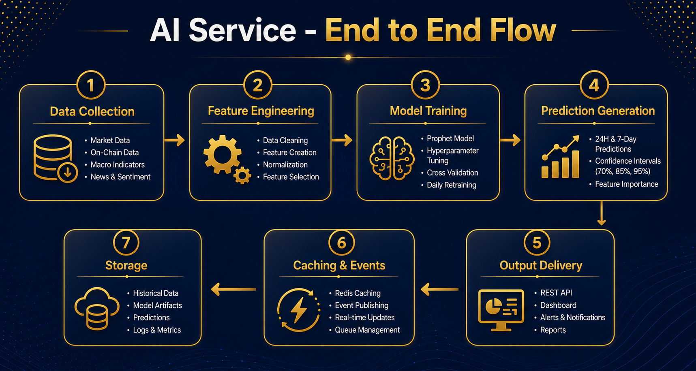


---

## STEP 1: DATA COLLECTION

### 1.1 What Data We Need

The AI Service needs historical data for training and real-time data for predictions:

| Category | Data Points | Source | Frequency |
|----------|-------------|--------|-----------|
| **BTC Market** | Price, Volume, Market Cap | CoinGecko / Binance | Real-time |
| **BTC Metrics** | Dominance, Active Addresses | CoinGecko / Glassnode | Daily |
| **Macroeconomic** | CPI, Interest Rate, M2, DXY, Treasury Yield | FRED API | Monthly/Daily |

### 1.2 Where Data Comes From

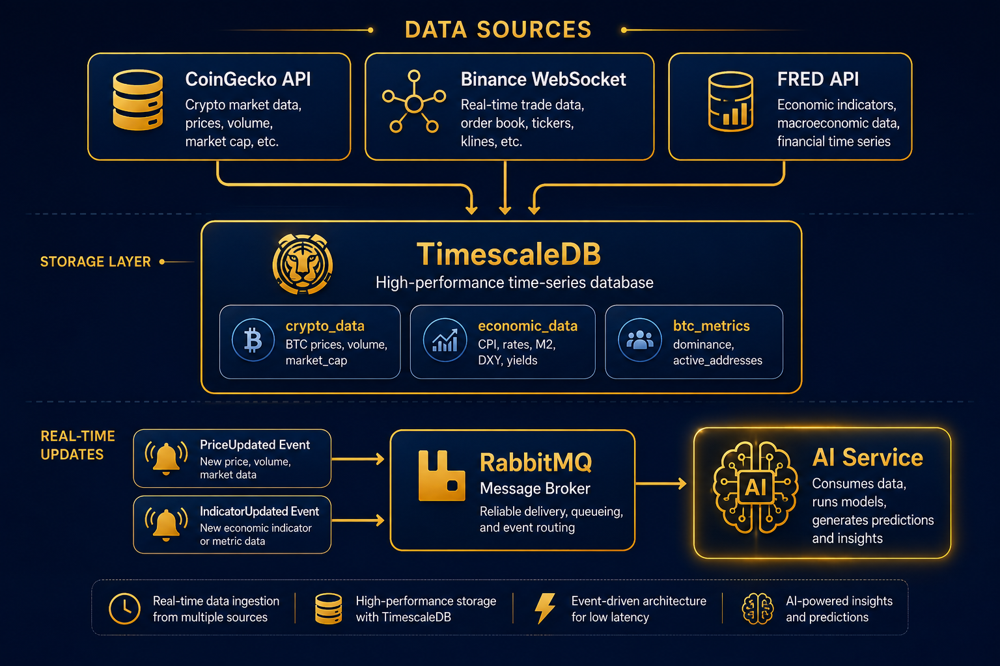


### 1.3 How AI Service Gets Data

The AI Service **does not** collect data directly. Instead:

1. **For Training (Daily at 6:00 AM UTC)** :
   - Queries TimescaleDB for last 90-180 days of historical data
   - Fetches: BTC prices, macro indicators, BTC metrics

2. **For Inference (Hourly)** :
   - Listens to RabbitMQ events (`PriceUpdated`, `IndicatorUpdated`)
   - Uses latest values from events or queries TimescaleDB

### 1.4 Data Preparation Steps

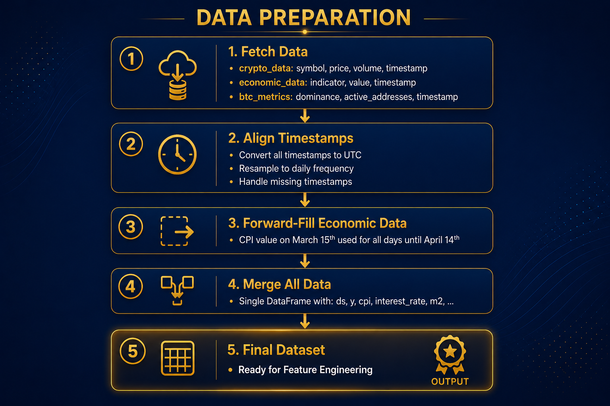


---

## STEP 2: FEATURE ENGINEERING

### 2.1 What Are Features?

Features are the **input variables** that Prophet uses to make predictions. The 10 features are:

| # | Feature | Type | Description |
|---|---------|------|-------------|
| 1 | CPI Inflation | Macro | Year-over-year inflation rate |
| 2 | Federal Funds Rate | Macro | Interest rate set by Fed |
| 3 | M2 Money Supply | Macro | Year-over-year money supply growth |
| 4 | US Dollar Index (DXY) | Macro | USD strength against major currencies |
| 5 | 10-Year Treasury Yield | Macro | Benchmark risk-free rate |
| 6 | BTC Price | BTC | Current price (with lags) |
| 7 | Trading Volume | BTC | 24-hour trading volume |
| 8 | Volatility | BTC | 7-day rolling standard deviation |
| 9 | BTC Dominance | BTC | BTC share of total crypto market cap |
| 10 | Active Addresses | BTC | 7-day moving average of active addresses |

### 2.2 Feature Engineering Process

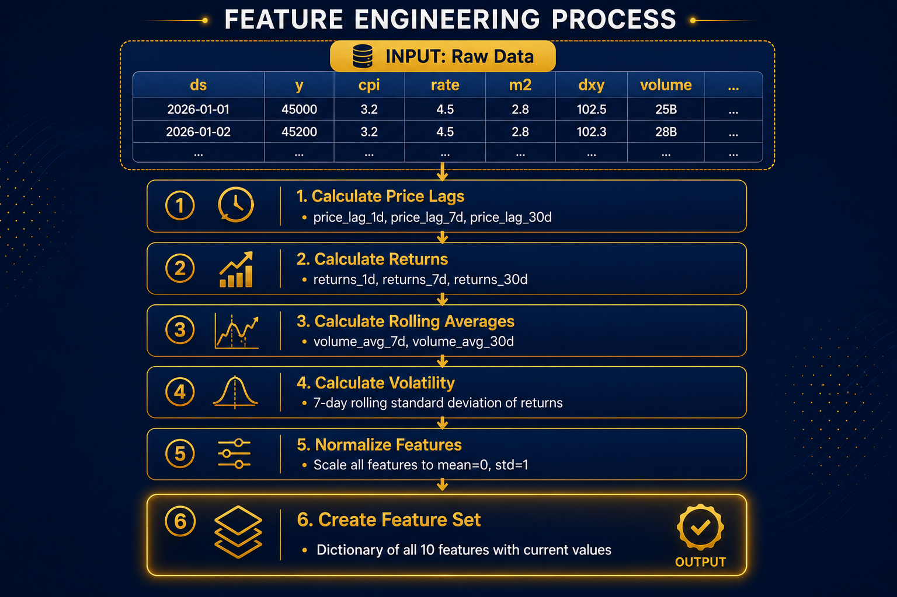


### 2.3 Example: Building Feature Set

```python
# What happens in code:
feature_set = {
    'cpi': 3.2,
    'interest_rate': 4.5,
    'm2_growth': 2.8,
    'dxy': 102.5,
    'treasury_yield': 4.2,
    'price': 61234.50,
    'price_lag_1d': 60800.00,
    'price_lag_7d': 59500.00,
    'volume': 25000000000,
    'volume_avg_7d': 22000000000,
    'volatility': 0.15,
    'dominance': 52.5,
    'active_addresses': 850000,
    'returns_1d': 0.007,
    'returns_7d': 0.029
}
```

### 2.4 Prophet DataFrame

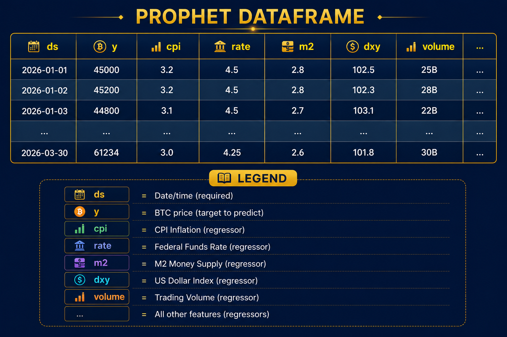


---

## STEP 3: MODEL TRAINING

### 3.1 Training vs. Retraining

| Type | When | What Happens | Duration |
|------|------|--------------|----------|
| **Initial Training** | First deployment | Train from scratch on historical data | Minutes |
| **Retraining** | Daily at 6:00 AM UTC | Train fresh model on updated data | Minutes |

### 3.2 Training Process

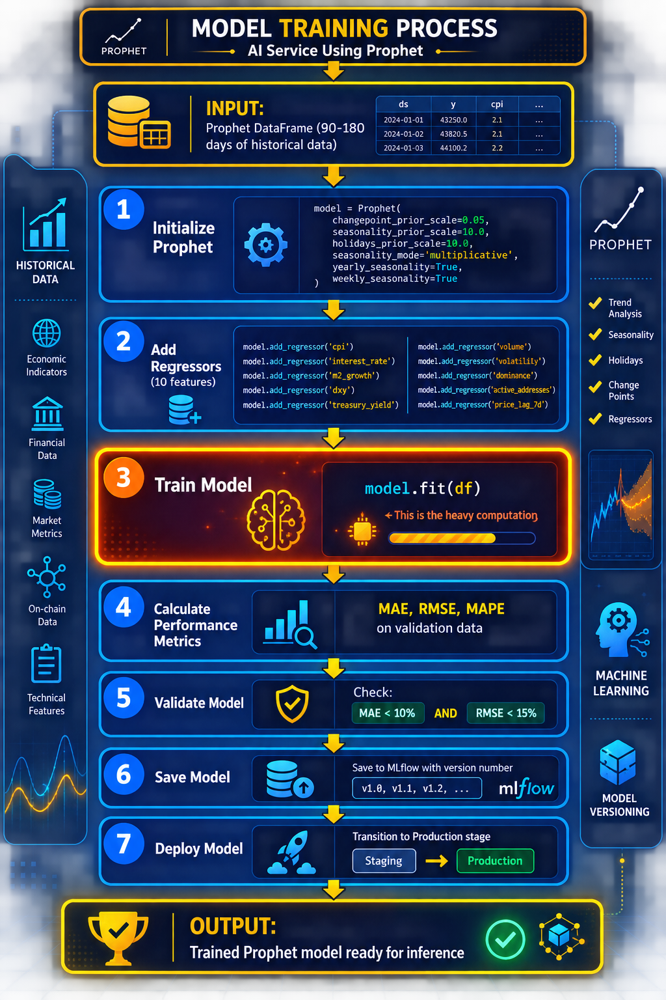


### 3.3 What Prophet Learns

During training, Prophet learns:

1. **Trend**: Overall direction (upward/downward)
2. **Seasonality**: Weekly, yearly patterns
3. **Regressor Coefficients**: How much each feature impacts price


Example of What Prophet Learns:

**Trend**: BTC has been in an upward trend since 2024

**Seasonality**: 
- Weekly: Higher prices on weekends, lower mid-week
- Yearly: Strong performance in Q4 (October-December)

**Regressor Coefficients**:
- CPI: +1.25 → 1% increase in CPI → +1.25% BTC price
- Interest Rate: -2.10 → 1% rate increase → -2.10% BTC price
- M2 Growth: +1.80 → 1% M2 growth → +1.80% BTC price
- DXY: -1.50 → 1% DXY increase → -1.50% BTC price
- Volume: +0.45 → 10% volume increase → +0.45% BTC price


---

## STEP 4: PREDICTION GENERATION (INFERENCE)

### 4.1 When Predictions Are Generated

| Horizon | Frequency | Trigger |
|---------|-----------|---------|
| **24-Hour** | Every hour | PriceUpdated event or schedule |
| **7-Day** | Daily | Scheduled at 6:00 AM UTC |

### 4.2 Inference Process

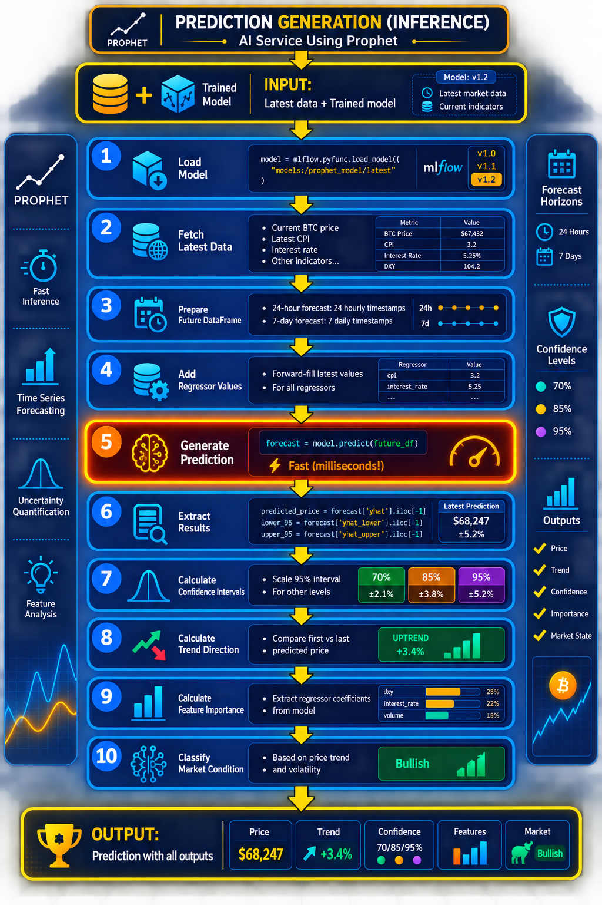


### 4.3 Example: 24-Hour Prediction

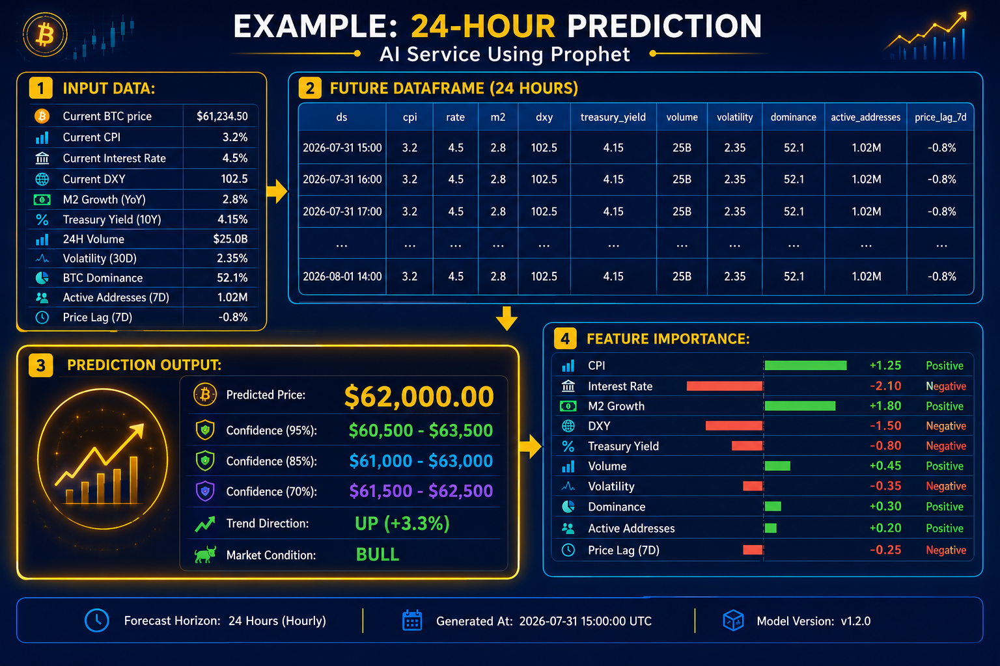


---

## STEP 5: STORAGE

### 5.1 Where Predictions Are Stored

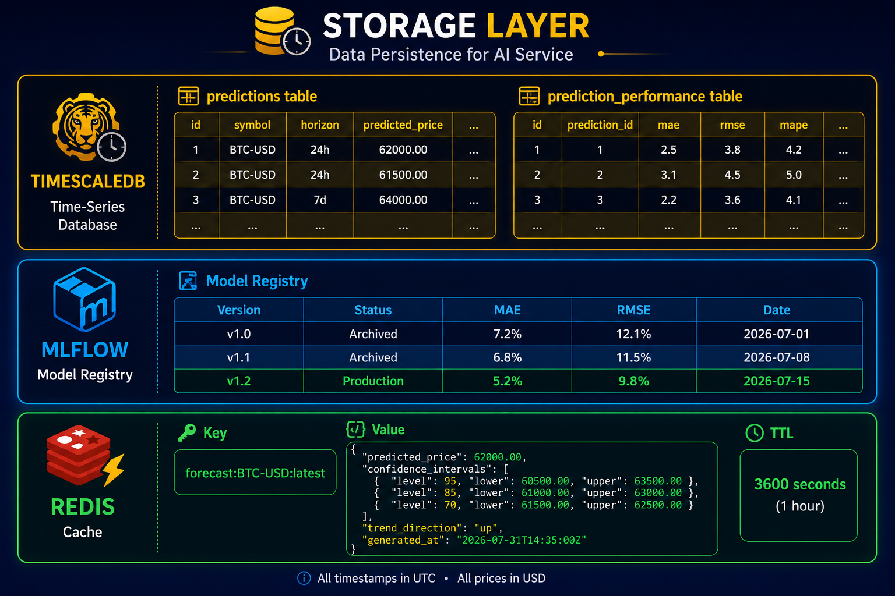


### 5.2 What Gets Stored

| Table/System | What's Stored |
|--------------|---------------|
| **TimescaleDB** | All predictions, confidence intervals, performance metrics |
| **MLflow** | Model files, version history, training metrics |
| **Redis** | Latest prediction (cached for fast API response) |

---

## STEP 6: CACHING & EVENTS

### 6.1 Redis Caching


### 6.2 Event Publishing (RabbitMQ)

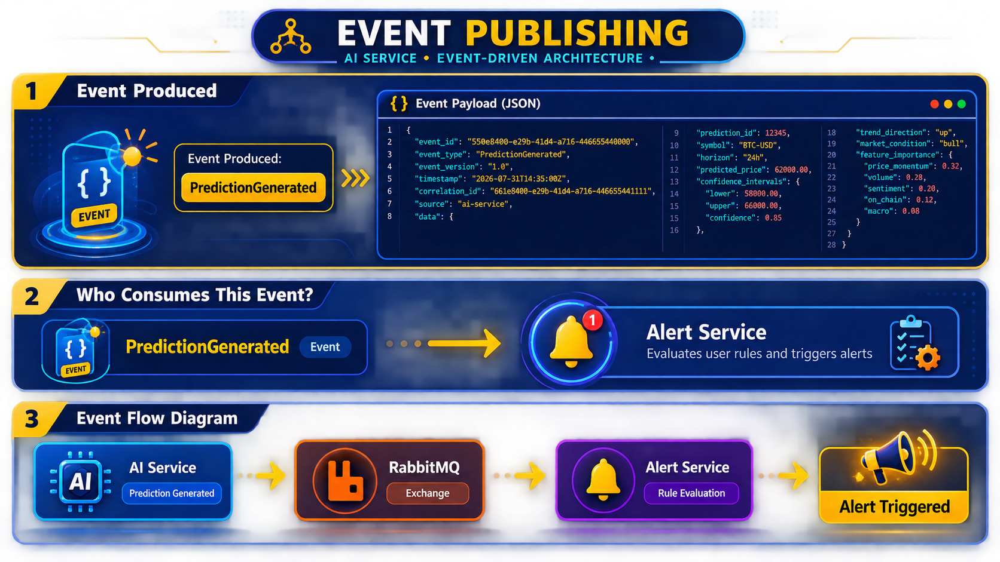


---

## STEP 7: OUTPUT DELIVERY

### 7.1 What Users Get

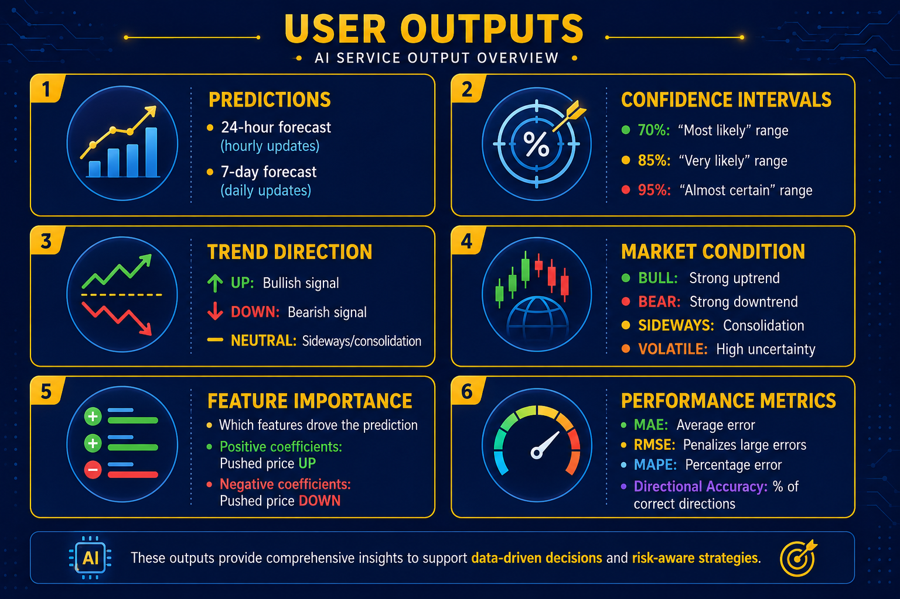


### 7.2 API Response Example

```http
GET /api/v1/predict/btc?horizon=24h
```


Response:


```json

{
    "prediction_id": 12345,
    "symbol": "BTC-USD",
    "horizon": "24h",
    "predicted_price": 62000.00,
    "forecast_time": "2026-08-01T14:30:00Z",
    "generated_at": "2026-07-31T14:35:00Z",
    "trend_direction": "up",
    "market_condition": "bull",
    "confidence_intervals": [
        {
            "level": 0.70,
            "lower": 61500.00,
            "upper": 62500.00
        },
        {
            "level": 0.85,
            "lower": 61000.00,
            "upper": 63000.00
        },
        {
            "level": 0.95,
            "lower": 60000.00,
            "upper": 64000.00
        }
    ],
    "feature_importance": {
        "cpi": 1.25,
        "interest_rate": -2.10,
        "m2_growth": 1.80,
        "dxy": -1.50,
        "treasury_yield": -0.75,
        "volume": 0.45,
        "volatility": -0.30,
        "dominance": 0.60,
        "active_addresses": 0.90,
        "price_lag_7d": 0.35
    },
    "model_version": "v1.0.3",
    "status": "generated"
}

```


### 7.3 Performance API Response Example

```http
GET /api/v1/performance/btc
```

Response:

```json

{
    "symbol": "BTC-USD",
    "model_version": "v1.0.3",
    "metrics": {
        "mae": 7.2,
        "rmse": 12.1,
        "mape": 8.5,
        "directional_accuracy": 62.5
    },
    "thresholds": {
        "mae_threshold": 10.0,
        "rmse_threshold": 15.0,
        "mae_exceeded": false,
        "rmse_exceeded": false
    },
    "status": "healthy",
    "last_updated": "2026-07-31T06:00:00Z",
    "sample_size": 30
}

```


### 📊 COMPLETE FLOW SUMMARY

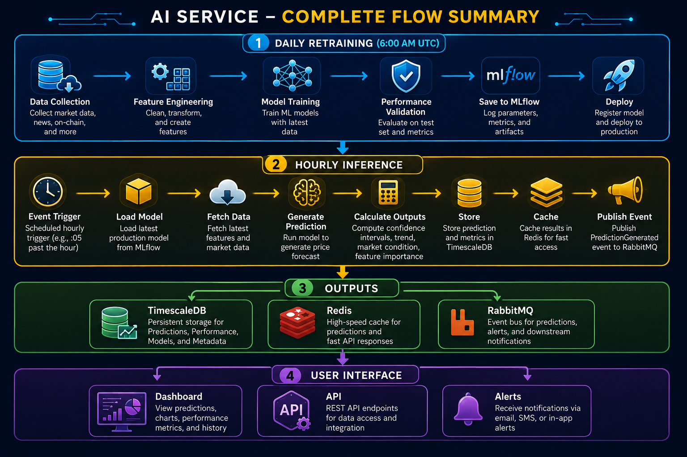


---

## 📌 KEY TAKEAWAYS

| Step | Key Points |
|------|------------|
| **Data Collection** | AI Service consumes events, doesn't collect directly |
| **Feature Engineering** | 10 features transformed into Prophet regressors |
| **Model Training** | Daily at 6:00 AM UTC, fresh model from scratch |
| **Prediction Generation** | Hourly for 24h, daily for 7d, milliseconds to execute |
| **Storage** | TimescaleDB (history), Redis (cache), MLflow (models) |
| **Outputs** | Predictions, confidence intervals, trend, market condition, feature importance |
| **Events** | PredictionGenerated published to RabbitMQ |

---

**Document Version:** 1.0  
**Last Updated:** 2026-09-02  
**Reviewers:** AI Service Team


