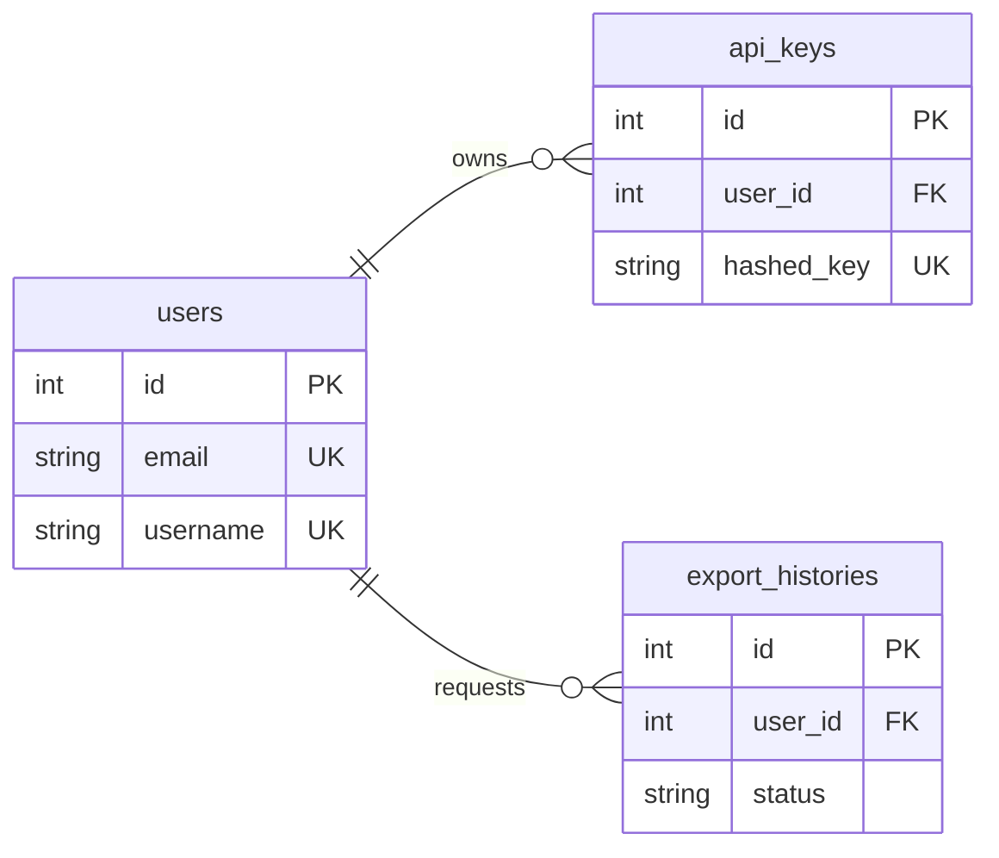
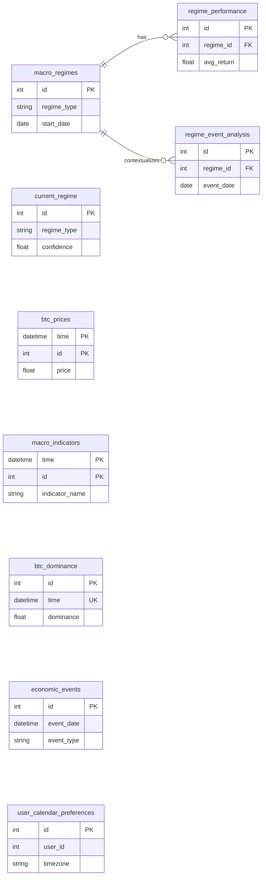
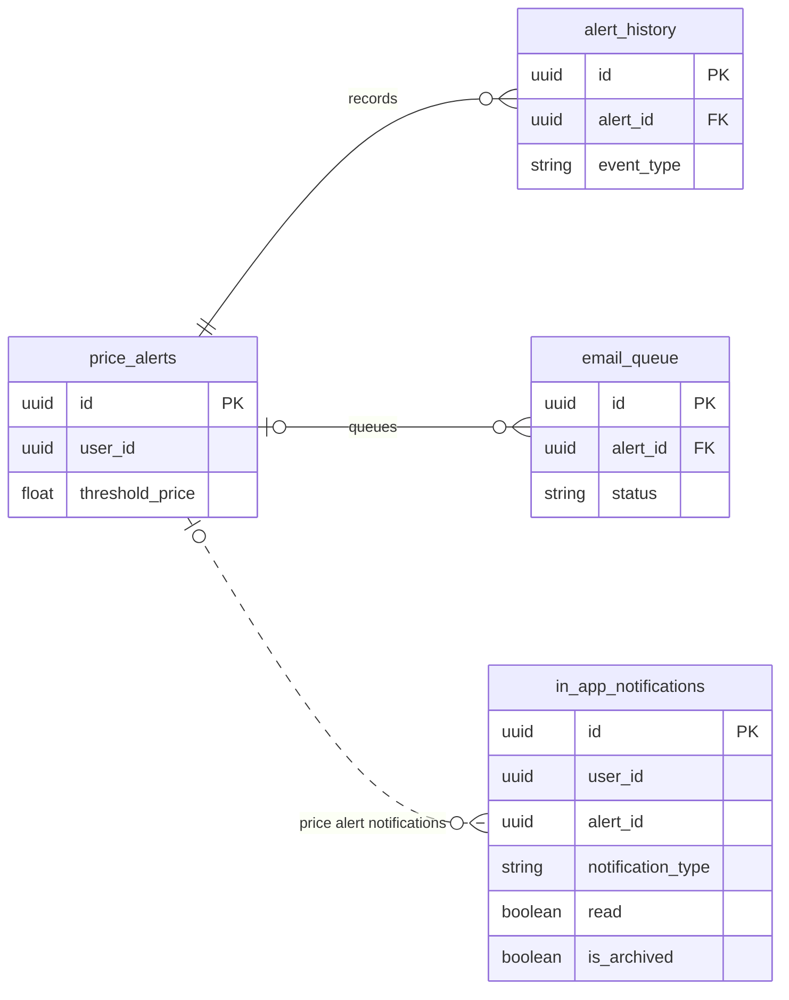
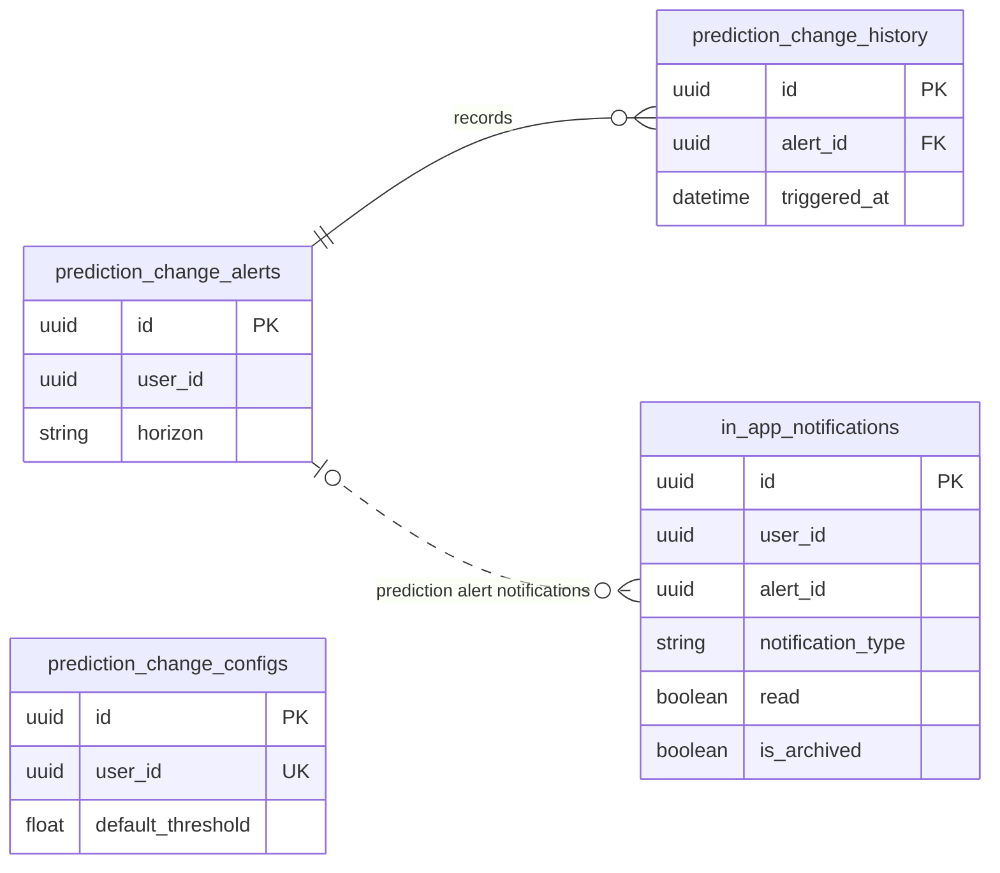
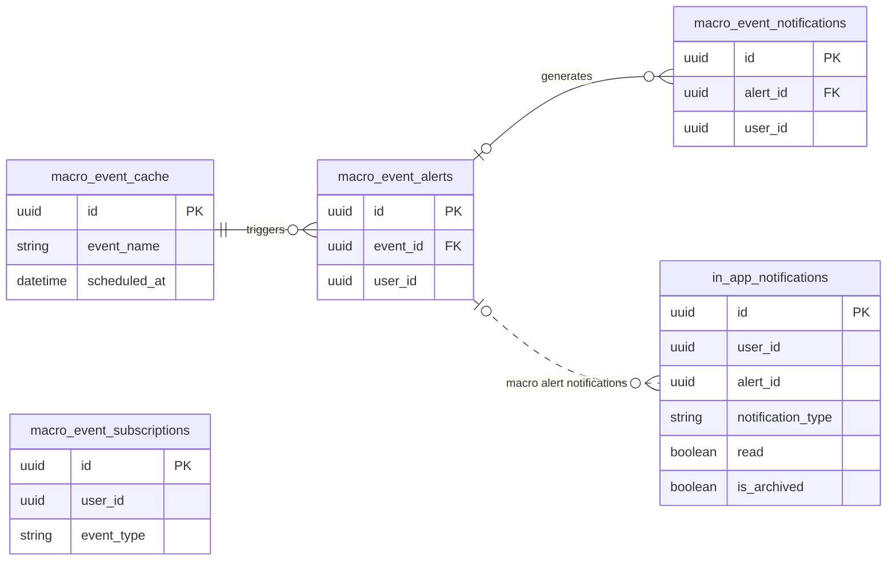

# Database Tables and Relationships

This document lists the database tables implemented by each service and
visualizes the relationships enforced between them.

Tables are related in the diagram when the database declares a foreign key,
typically because one record belongs to another and referential integrity
should be enforced (for example, an alert history entry belongs to an alert).
Tables without a drawn relationship are standalone in the database schema:
they may hold independent time-series, configuration, aggregate, or audit
data, or be associated through application logic rather than a foreign key.

## Tables by service

### AI Service — 18 tables

| Table | Description |
|---|---|
| `schema_migrations` | Tracks which AI Service schema migrations have been applied. |
| `btc_predictions` | Stores BTC price forecasts across supported models, horizons, and confidence levels. |
| `prediction_performance` | Records forecast evaluations against observed BTC prices and related error metrics. |
| `threshold_breaches` | Logs when model performance metrics exceed configured thresholds. |
| `model_performance` | Stores aggregate accuracy metrics for each model and forecast horizon. |
| `btc_macro_correlation` | Stores calculated correlations between BTC and macroeconomic indicators. |
| `export_history` | Tracks AI data export requests, status, format, and download details. |
| `historical_event_impacts` | Stores BTC price reactions and volatility around historical economic events. |
| `model_champions` | Tracks the active champion model by forecast horizon and optional market regime. |
| `champion_candidates` | Records daily top model candidates used by the promotion stability process. |
| `btc_predictions_cli` | Isolated CLI-run copy of BTC prediction records. |
| `prediction_performance_cli` | Isolated CLI-run copy of prediction evaluation records. |
| `threshold_breaches_cli` | Isolated CLI-run copy of threshold breach records. |
| `model_performance_cli` | Isolated CLI-run copy of aggregate model performance records. |
| `btc_macro_correlation_cli` | Isolated CLI-run copy of BTC/macro correlation records. |
| `historical_event_impacts_cli` | Isolated CLI-run copy of historical event impact records. |
| `model_champions_cli` | Isolated CLI-run copy of champion model state. |
| `champion_candidates_cli` | Isolated CLI-run copy of champion candidate records. |

### Data Service — 9 tables

| Table | Description |
|---|---|
| `btc_prices` | Time-series BTC market prices and associated market data. |
| `macro_indicators` | Time-series values for macroeconomic indicators such as CPI and interest rates. |
| `btc_dominance` | Historical Bitcoin share of total cryptocurrency market capitalization. |
| `macro_regimes` | Historical periods classified into macroeconomic regimes. |
| `regime_performance` | BTC return, drawdown, volatility, and related metrics for a regime. |
| `current_regime` | Current regime classification, confidence, visual indicator, and expiry. |
| `regime_event_analysis` | BTC price response to economic events within a macro regime. |
| `economic_events` | Economic calendar events with scheduled time, type, impact, and description. |
| `user_calendar_preferences` | Per-user calendar display preferences, including timezone. |

### Alert Service — 11 tables

| Table | Description |
|---|---|
| `price_alerts` | User-configured BTC price thresholds and alert status. |
| `alert_history` | Audit trail of price alert updates, evaluations, and triggers. |
| `in_app_notifications` | Shared in-app notification store for price, prediction, and macro alert notifications, with type, read, and archive status. |
| `macro_event_alerts` | User alerts tied to a specific cached macroeconomic event. |
| `macro_event_subscriptions` | User preferences for macro-event categories, impact, timing, and delivery. |
| `macro_event_notifications` | Notifications generated for upcoming macroeconomic events. |
| `macro_event_cache` | Cached macro calendar event details and notification state. |
| `prediction_change_alerts` | User rules for changes in prediction price or confidence. |
| `prediction_change_history` | History of triggered prediction-change alerts and notification results. |
| `prediction_change_configs` | Per-user default thresholds and preferences for prediction alerts. |
| `email_queue` | Pending and completed alert emails with retry and delivery details. |

### API Gateway — 3 tables

| Table | Description |
|---|---|
| `users` | User accounts, credentials, profile, role, and account status. |
| `api_keys` | Hashed API credentials, permissions, expiry, and usage metadata. |
| `export_histories` | User export jobs, generated file details, status, and download tracking. |

**Total: 41 application tables.**

## Entity-relationship diagrams

Each service diagram is separate for readability. Solid relationships
represent database foreign keys. Dotted relationships in the Alert Service
diagram show logical associations used by the unified notifications API; those
generic alert links are not database foreign keys.

### API Gateway

### Data Service

### AI Service

```mermaid
erDiagram
    direction LR
    btc_predictions o|--o{ prediction_performance : evaluated_by

    btc_predictions {
        datetime time PK
        datetime prediction_time PK
        string horizon PK
        string model_name PK
        float confidence PK
        bigint id UK
    }
    prediction_performance {
        bigint id PK
        bigint prediction_id FK
        datetime forecast_date FK
        string model_name
        float actual_price
    }
    schema_migrations {
        string version PK
        datetime applied_at
    }
    threshold_breaches {
        bigint id PK
        string model_name
        string metric
    }
    model_performance {
        bigint id PK
        string model_name
        string horizon
    }
    btc_macro_correlation {
        string indicator_name PK
        int window_days PK
        datetime calculated_at PK
    }
    export_history {
        bigint id PK
        string export_type
        string status
    }
    historical_event_impacts {
        bigint id PK
        string event_name
        date event_date
    }
    model_champions {
        bigint id PK
        string model_name
        string horizon
    }
    champion_candidates {
        bigint id PK
        date candidate_date
        string model_name
    }
    btc_predictions_cli {
        datetime time
        datetime prediction_time
    }
    prediction_performance_cli {
        bigint id
        string model_name
    }
    threshold_breaches_cli {
        bigint id
        string metric
    }
    model_performance_cli {
        bigint id
        string model_name
    }
    btc_macro_correlation_cli {
        string indicator_name
        int window_days
        datetime calculated_at
    }
    historical_event_impacts_cli {
        bigint id
        string event_name
    }
    model_champions_cli {
        bigint id
        string model_name
    }
    champion_candidates_cli {
        bigint id
        date candidate_date
    }
```

The prediction-performance link is optional because backtest rows can have a
NULL `prediction_id`. When present, the composite foreign key is
`prediction_performance(prediction_id, forecast_date)` to
`btc_predictions(id, time)`.

### Alert Service

#### Price alerts

#### Prediction alerts

#### Macro-event alerts

`GET /api/v1/notifications` reads from `in_app_notifications`, the shared
store used by price, prediction, and macro alert creation. Its `alert_id` is
a generic UUID and has no foreign key because it can identify a record in any
of those three alert tables; `notification_type` identifies the alert
category. The dotted links above show that application-level association.

`macro_event_notifications` is also present for macro-specific notification
operations, but it is separate from the unified endpoint's query. Macro alert
creation writes to the shared `in_app_notifications` store for the unified
feed.
