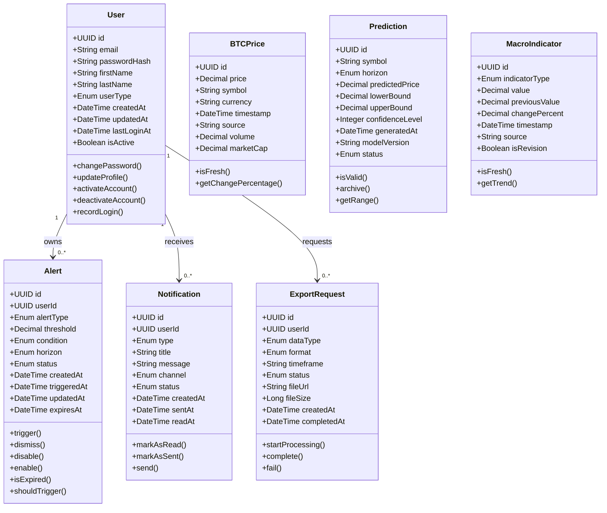
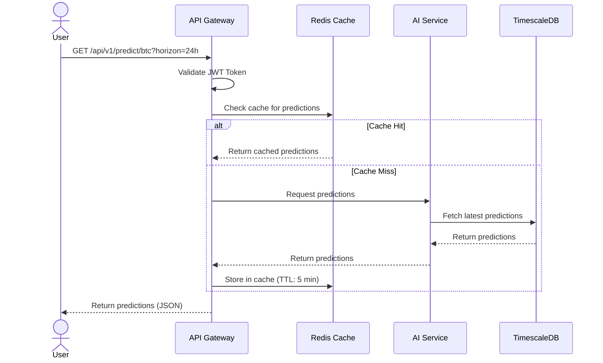
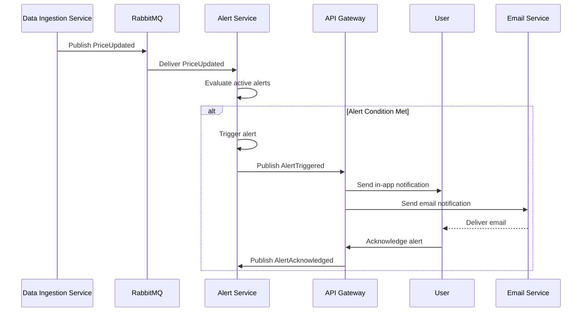
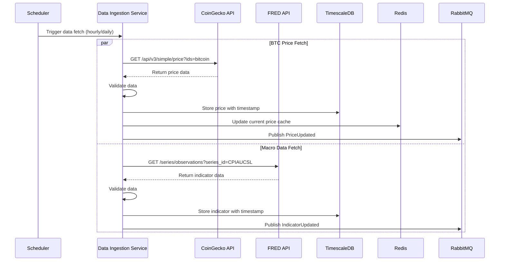
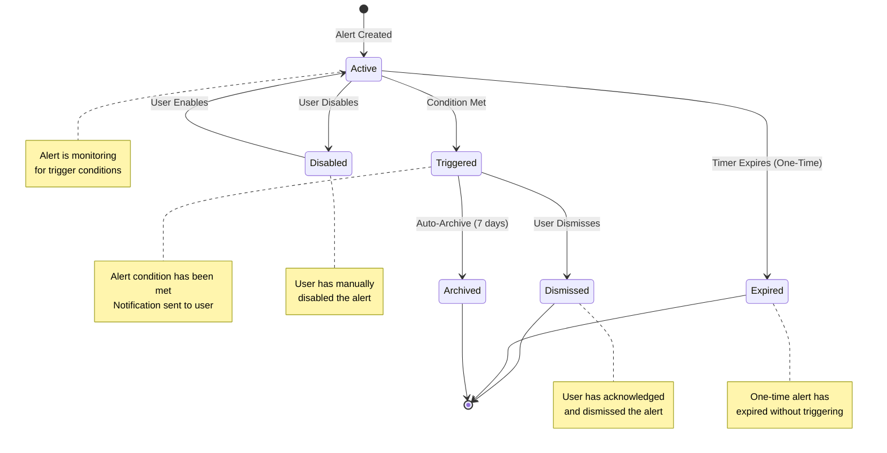
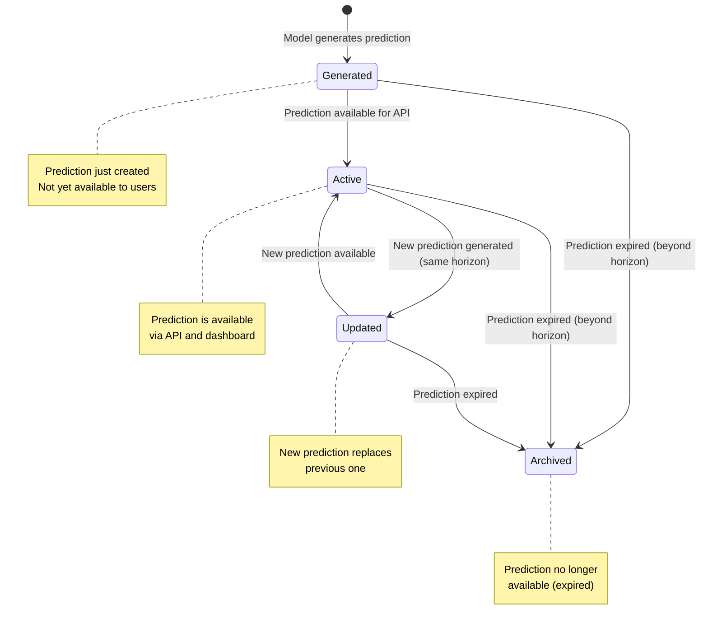
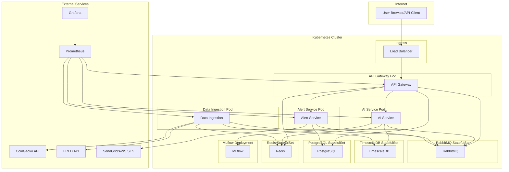

# UML Diagrams — MacroCrypto AI

This document contains all UML diagrams for the MacroCrypto AI platform using Mermaid syntax.

---

## 1. Domain Class Diagram [8.1]

---

## 2. Sequence Diagram: BTC Prediction Flow [8.2]

---

## 3. Sequence Diagram: Alert Trigger Flow [8.3]

---

## 4. Sequence Diagram: Data Ingestion Flow [8.4]

---

## 5. Component Diagram [8.5]

```mermaid
graph TB
    subgraph "MacroCrypto AI Platform"
        subgraph "API Gateway"
            REST[REST Controllers]
            Auth[Authentication Middleware]
            RateLimit[Rate Limiting Middleware]
            UserService[User Service]
            ExportService[Export Service]
            EventProducer[Event Producer]
            EventConsumer[Event Consumer]
        end

        subgraph "AI Service"
            FeatureEng[Feature Engineering]
            ModelTraining[Model Training]
            PredictionGen[Prediction Generator]
            ModelRegistry[Model Registry]
            CacheManager[Cache Manager]
            AIEventConsumer[Event Consumer]
            AIEventProducer[Event Producer]
        end

        subgraph "Data Ingestion Service"
            CoinGeckoClient[CoinGecko Client]
            FREDClient[FRED Client]
            DataValidator[Data Validator]
            DataStorage[Data Storage]
            DataCacheManager[Cache Manager]
            DIEventProducer[Event Producer]
            Scheduler[Scheduler]
        end

        subgraph "Alert Service"
            AlertEngine[Alert Engine]
            AlertManager[Alert Manager]
            NotificationService[Notification Service]
            AlertEventConsumer[Event Consumer]
            AlertEventProducer[Event Producer]
        end
    end

    subgraph "External Systems"
        CoinGecko[CoinGecko API]
        FRED[FRED API]
        Email[SendGrid/AWS SES]
        MLflow[MLflow]
    end

    subgraph "Infrastructure"
        RabbitMQ[RabbitMQ]
        TimescaleDB[TimescaleDB]
        PostgreSQL[PostgreSQL]
        Redis[Redis]
    end

    %% Connections
    REST --> Auth --> RateLimit
    RateLimit --> UserService
    RateLimit --> ExportService
    
    CoinGeckoClient --> CoinGecko
    FREDClient --> FRED
    DataStorage --> TimescaleDB
    DataCacheManager --> Redis
    DIEventProducer --> RabbitMQ
    DIEventConsumer --> RabbitMQ
    
    PredictionGen --> ModelRegistry
    CacheManager --> Redis
    AIEventProducer --> RabbitMQ
    AIEventConsumer --> RabbitMQ
    
    NotificationService --> Email
    AlertManager --> PostgreSQL
    AlertEventProducer --> RabbitMQ
    AlertEventConsumer --> RabbitMQ
    
    UserService --> PostgreSQL
    ExportService --> EventProducer
    EventProducer --> RabbitMQ
    EventConsumer --> RabbitMQ
```

---

## 6. State Machine Diagram: Alerts [8.6]

---

## 7. State Machine Diagram: Predictions [8.7]

---

## 8. Deployment Diagram [8.8]

---

## Version History

| Version | Date | Author | Changes |
|---------|------|--------|---------|
| 1.0 | 2026-08-07 | Sid | Initial version — all UML diagrams complete |