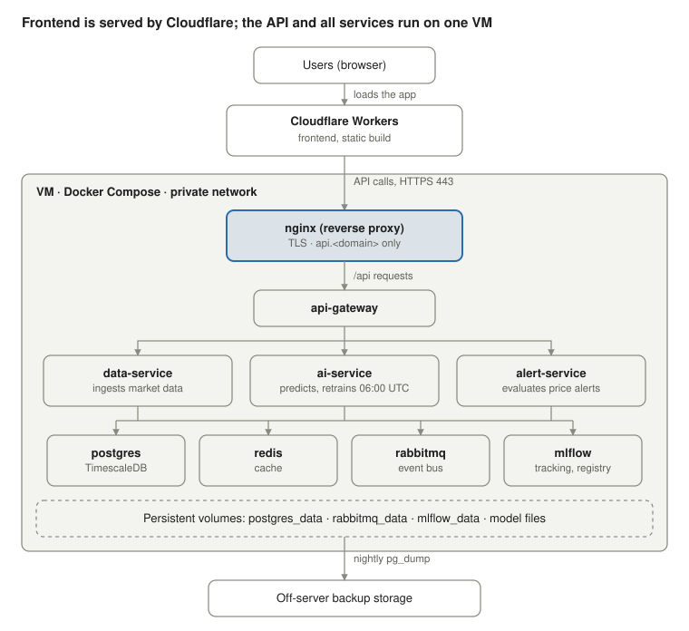

# MacroCrypto AI — Deployment Platform Analysis

_Last updated: 2026-10-09_

## Summary

Deploy the whole stack to **one Linux VM (4 vCPU, 8–16 GB RAM, 50+ GB SSD) running Docker Compose**. No GPU is needed.

The models are CPU-bound tabular and time-series models: Prophet, XGBoost, LightGBM and scikit-learn. They retrain once a day inside `ai-service`. A single VM gives that job enough CPU and RAM, and it gives persistent disk for model files, MLflow artifacts and TimescaleDB. It also reuses the existing `docker-compose.yml`, so the deploy needs the least new work before the demo.

Recommended providers, in order: Hetzner Cloud (cheapest), DigitalOcean (covered by GitHub Student Pack credit), or AWS EC2 / GCP Compute Engine if the team already has credits there.

## What we are deploying

The app is 9 containers, all defined in `docker-compose.yml`. The frontend is a static Vite build.

| Component | Image / source | Role | Needs persistent data |
| --- | --- | --- | --- |
| postgres | `timescale/timescaledb:2.17.2-pg15` | Main database, time-series storage | Yes |
| redis | `redis:7-alpine` | Cache (predictions, prices) | Optional |
| rabbitmq | `rabbitmq:3-management-alpine` | Event bus between services | Yes |
| mlflow | `ghcr.io/mlflow/mlflow:v2.18.0` | Experiment tracking, model registry | Yes |
| data-service | `services/data-service` | Ingests market and macro data | No |
| ai-service | `services/ai-service` | Predictions and daily retraining | Yes (model files) |
| alert-service | `services/alert-service` | Price alerts and notifications | No |
| api-gateway | `services/api-gateway` | Single public API for the frontend | No |
| frontend | `frontend/` (Vite + React) | Web UI, built to static files | No |

**ML workload.** `ai-service` uses Prophet, XGBoost, LightGBM, scikit-learn, pandas and MLflow (`services/ai-service/requirements.txt`). None of these need a GPU for this data size. An APScheduler job (`app/scheduler/jobs.py`) retrains all 6 model variants daily at 06:00 UTC. It saves each variant to local disk and logs runs to MLflow.

## Requirements from the codebase

The platform must run long-lived containers with persistent disk; GPU is not a requirement.

| Need | Why | Implication |
| --- | --- | --- |
| CPU for training | Daily retrain of 6 variants (Prophet, XGBoost, LightGBM) | 4 vCPU is enough; training takes minutes, not hours |
| RAM | 9 containers + pandas frames during training | 8 GB minimum, 16 GB comfortable |
| Persistent disk | Postgres/Timescale, RabbitMQ, MLflow artifacts, saved model files | Volumes that survive restarts and redeploys |
| Always-on processes | Scheduler, RabbitMQ consumers, alert checks | No scale-to-zero or cold starts |
| Private networking | Services call each other by name (`postgres`, `rabbitmq`, `mlflow`) | All services on one network; only the gateway and UI are public |
| Public HTTPS | Frontend and API gateway | Reverse proxy with TLS |

Open question: the expected data volume after a few months of ingestion. It decides whether 50 GB of disk lasts.

## Platform options compared

A single VM with Docker Compose fits best: it matches how the app already runs and handles training with no extra parts.

| Option | Examples | Fit for this app | Main drawback |
| --- | --- | --- | --- |
| **VM + Docker Compose** (recommended) | Hetzner Cloud, DigitalOcean Droplet, AWS EC2, GCP Compute Engine | Runs the existing compose file almost as is; persistent disk; full CPU for training | We patch the OS, run backups and set up TLS ourselves |
| PaaS | Render, Railway, Fly.io | Simple deploys per service | Billed per service (9 here); per-container memory caps; TimescaleDB and RabbitMQ are hard to host; weak persistent volumes |
| Managed ML | AWS SageMaker, GCP Vertex AI | Strong for large or GPU training | Overkill and costly for CPU models; still need a host for the other 8 services |
| Managed containers | AWS ECS/Fargate, GCP Cloud Run, Azure Container Apps | Scales well, managed runtime | Much more setup (networking, IAM, managed DB, queues); Cloud Run scale-to-zero breaks the scheduler |
| Kubernetes | EKS, GKE, DOKS | Production-grade scaling | Far too much operational work for a 9-container student project |

Prices vary by region and change often, so they are left out here; check each provider's pricing page before choosing.

## Recommendation and sizing

Choose the provider by where the team has credits; the setup is the same on all four.

| Provider | Suggested instance | vCPU / RAM | When to pick it |
| --- | --- | --- | --- |
| Hetzner Cloud | CX32 or CX42 | 4 / 8 GB or 8 / 16 GB | Lowest cost, EU data centres |
| DigitalOcean | Basic or General Purpose Droplet | 4 / 8 GB or 4 / 16 GB | GitHub Student Pack credit available |
| AWS EC2 | t3.xlarge or m6i.xlarge | 4 / 16 GB | Team or course already has AWS credits |
| GCP Compute Engine | e2-standard-4 | 4 / 16 GB | Team or course already has GCP credits |

Use Ubuntu 24.04 LTS, at least 50 GB SSD and a static public IP. Point a domain (or a free subdomain) at it for TLS.

The browser loads the frontend from Vercel. API calls go only to nginx on 443 on the VM. Services reach the databases, queue and MLflow by name on the private Docker network, and stateful data lives on persistent volumes that are backed up nightly.

## Production readiness changes

The current compose file is set up for local development and needs a `docker-compose.prod.yml` override before going public.

- [ ] Remove dev bind mounts (`./services/*/app:/app/app`, `./shared:/app/shared`) so images run the code they were built with
- [ ] Replace hardcoded credentials (Postgres `macro`/`crypto`, RabbitMQ `guest`/`guest`) with values from a server-only `.env` file
- [ ] Stop publishing internal ports (5432, 6379, 5672, 15672, 5001, 8001–8003) to the host; expose only 80/443
- [ ] Enable the reverse proxy (the commented-out `nginx` service, or Caddy) with TLS certificates for `api.<domain>` only
- [ ] Deploy the frontend to Vercel (see [Frontend on Vercel](#frontend-on-vercel)), not from the VM
- [ ] Add a named volume for `ai-service` model files so trained models survive redeploys
- [ ] Move MLflow's backend store from SQLite to the Postgres instance (optional, more robust)
- [ ] Set the gateway's `CORS_ALLOW_ORIGINS` to the Vercel production domain
- [ ] Add a nightly `pg_dump` backup copied off the server

## Frontend on Vercel

**Steps**

1. In Vercel, click **Add New… → Project**. If `macrocrypto-ai` is not listed, click **Adjust GitHub App Permissions**.
2. On GitHub, choose the **TheQuintet** organisation, select **Only select repositories**, pick **macrocrypto-ai**, and click **Install**.
3. Back in Vercel, refresh. Click **Import** next to `TheQuintet/macrocrypto-ai`. Don't use a Deploy template.
4. Set **Project Name** to `macrocrypto-ai`.
5. Keep **Framework Preset** as **Vite**.
6. Click **Edit** next to **Root Directory**, choose `frontend`, and click **Continue**.
7. Leave **Build Command** as `npm run build` and **Output Directory** as `dist`.
8. Expand **Environment Variables**. Add Name `VITE_API_GATEWAY_BASE_URL`, Value `https://api.<domain>`, Environment **Production**.
9. Click **Deploy**. Copy the `https://<project>.vercel.app` URL shown after the deploy.
10. On the VM, set `CORS_ALLOW_ORIGINS=["https://<project>.vercel.app"]` and restart `api-gateway`.
11. In Vercel, open **Deployments**, choose the latest deployment, click **⋯ → Redeploy** after any change to step 8.
12. Open the Vercel URL. In DevTools → Network, API calls go to `https://api.<domain>/...` with no CORS errors. Reload `/macro`; it must load.

**Optional:** in Vercel, **Settings → Domains**, add `app.<domain>`, and add `https://app.<domain>` to `CORS_ALLOW_ORIGINS` on the VM.

**If something fails**

- Repo not listed → repeat steps 1–2.
- Build error "package.json not found" → **Settings → General → Root Directory** must be `frontend`; then Redeploy.
- Simulated data, no error → fix step 8 and Redeploy.
- CORS error in the console → fix step 10 and restart `api-gateway`.
- 404 on `/macro` → `frontend/vercel.json` is missing; merge PR #803.

## Frontend deploy on Cloudflare

Use this instead of Vercel if the Vercel project can't deploy from the private organisation repo on the Hobby plan. The repo already contains `frontend/wrangler.jsonc`, which serves `dist` as a single-page app.

**Steps**

1. In the Cloudflare dashboard, click **Compute → Workers & Pages → Create → Create an app**.
2. Under **Select a method**, choose **Connect a Git repository**, not **Clone a public repository via Git URL**.
3. If `macrocrypto-ai` isn't listed, click **Configure GitHub**, grant Cloudflare access to the TheQuintet organisation, and select the repo.
4. Select `TheQuintet/macrocrypto-ai` and click **Next**.
5. Set **Root directory** to `frontend`. Open **Advanced settings** if the field isn't on the screen.
6. Set **Build command** to `npm run build`.
7. Set **Deploy command** to `npx wrangler deploy`. Leave the default.
8. Turn off **Enable Preview builds**.
9. In **Advanced settings → Environment variables**, add `VITE_API_GATEWAY_BASE_URL` = `https://api.<domain>`. It must be set before the build runs.
10. Click **Deploy**. Copy the `https://macrocrypto-ai.<your-subdomain>.workers.dev` URL shown after the deploy.
11. On the VM, set `CORS_ALLOW_ORIGINS=["https://macrocrypto-ai.<your-subdomain>.workers.dev"]` and restart `api-gateway`.
12. After you change any variable, redeploy from the Worker's **Deployments** page.
13. Open the site. In DevTools → Network, API calls go to `https://api.<domain>/...` with no CORS errors. Reload `/macro`; it must load.

**If something fails**
- Repo not listed → repeat step 3.
- Build error "package.json not found" → **Root directory** must be `frontend`.
- Simulated data, no error → fix step 9 and redeploy.
- CORS error in the console → fix step 11.
- Deployment fails at the deploy step → check that `frontend/wrangler.jsonc` is in the repo.

## Deployment steps

Run the VM steps once the production override from the previous section exists. The frontend steps are in [Frontend on Vercel](#frontend-on-vercel).

1. **Provision the VM.** Create a 4 vCPU / 8–16 GB Ubuntu 24.04 instance with 50+ GB SSD. Add your SSH key and reserve a static IP.
2. **Point DNS.** Create an A record for `api.<domain>` pointing at the VM. The frontend's domain is handled by Vercel.
3. **Harden the server.**
   - Create a non-root user with sudo; disable SSH password and root login.
   - Enable the firewall (`ufw`) and allow only 22, 80 and 443.
   - Turn on unattended security upgrades.
4. **Install Docker.** Install Docker Engine and the Compose plugin from Docker's official apt repository.
5. **Get the code.** Clone the repo on the server and check out the release tag or `main`.
6. **Configure secrets.** Create each service's `.env` (`services/*/.env`) and a root `.env` with strong DB and RabbitMQ passwords. Never commit them.
7. **Build and start.** Run `docker compose -f docker-compose.yml -f docker-compose.prod.yml up -d --build`.
8. **Initialise data.** Run DB migrations and the initial data load, then trigger a first training run so models exist before the scheduler fires.
9. **Verify.**
   - All containers report healthy in `docker compose ps`.
   - `https://api.<domain>/health` returns OK.
   - The Vercel frontend loads, shows prices and predictions, and alerts fire.
   - MLflow lists the new training runs.
10. **Operate.**
    - Check the next day that the 06:00 UTC retrain ran.
    - Confirm the nightly backup landed off-server.
    - Redeploy with `git pull` + the same `up -d --build` command, or automate it from GitHub Actions over SSH.

## Future scaling

Keep the app on the VM. Move only training elsewhere if one of these happens:

- **Deep learning models** (LSTMs, transformers): run training as a separate job on a GPU instance or a service such as Modal. Log to the same MLflow server, and let `ai-service` load the registered model.
- **Retraining slows the live API**: move the retrain job into its own container, or onto a second VM, so prediction serving keeps its CPU.
- **Data outgrows the disk or needs high availability**: move Postgres to a managed database (with TimescaleDB support) and MLflow artifacts to object storage (S3, GCS, Spaces).
